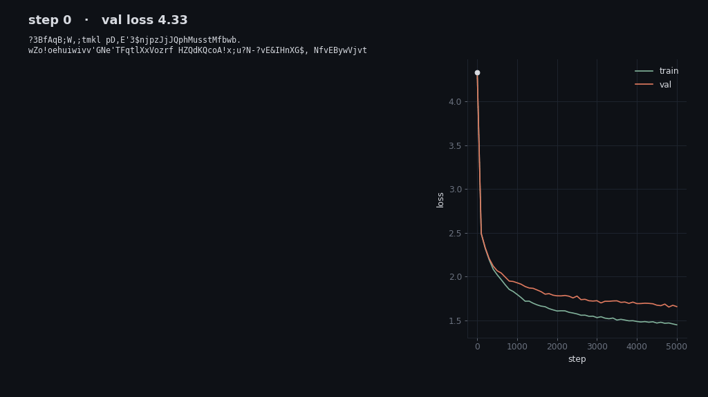
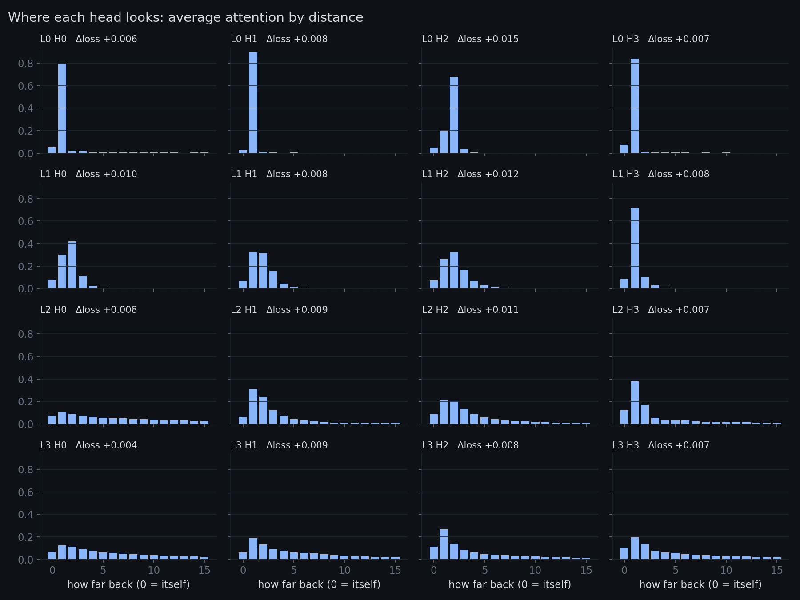
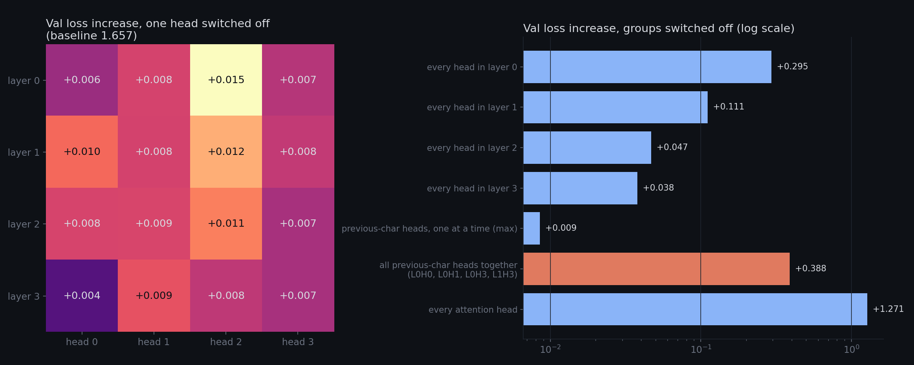
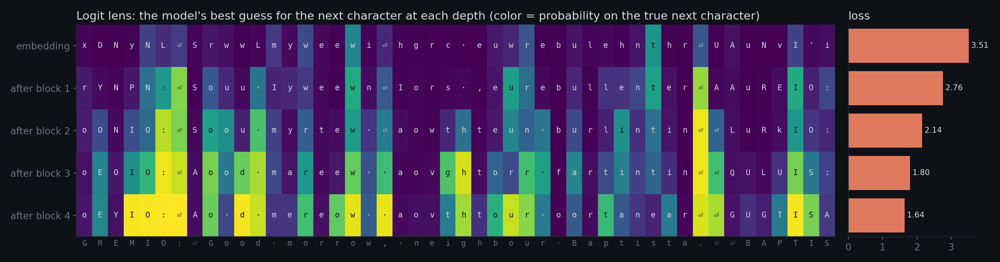
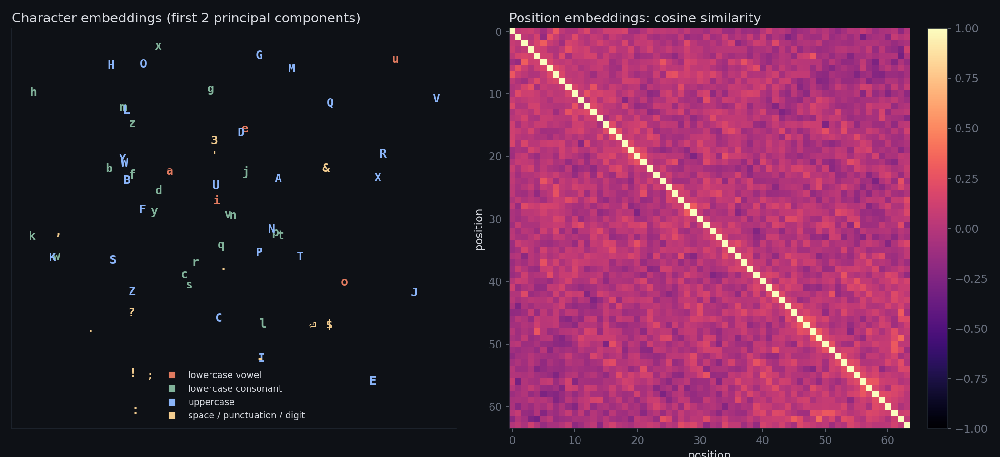

# Attention Explorer

A 0.8M-parameter character-level GPT trained on Tiny Shakespeare, then opened up: which characters each attention head reads, which heads the model actually needs, and how the prediction forms layer by layer.

**[Interactive explorer →](https://gabrielmpr.github.io/attention-explorer/)** Hover any character to see where each of the 16 heads looks from it.



The model is the decoder-only transformer from Karpathy's *Let's build GPT* (4 layers, 4 heads, 128-dim embeddings, 64-character context), trained for 5,000 steps to a validation loss of 1.66. Everything below is analysis of that trained model.

## Findings

**1. Layer 0 is a lookup table for the last two characters.** Three of its four heads put 80–89% of their attention on the previous character. The fourth, L0H2, puts 68% on the character two back. Layer 1 reads a 1–4 character window. Layers 2 and 3 spread out across the whole context.



**2. No single head matters, because they back each other up.** Switching off any one head raises validation loss by 0.004–0.015. The four previous-character heads cover for each other: switch off one and loss rises by at most 0.009, switch off all four together and it rises by 0.388, about 40× more. Removing whole layers shows the early layers do most of the work: layer 0's attention is worth 0.295, layer 3's only 0.038. Removing every attention head costs 1.27, which leaves the model worse than a plain bigram model (about 2.5), since every later layer was trained to expect attention's output.



**3. The prediction sharpens with depth.** Decoding the residual stream after each block with the final LayerNorm and output layer (the "logit lens"), loss falls 3.51 → 2.76 → 2.14 → 1.80 → 1.64. By the last block the model knows that a name in capitals ends in a colon and a newline, and that a capital letter follows the newline.



**4. The embeddings are less structured than you'd hope at this size.** In 2-D, punctuation drifts to one corner but vowels and consonants don't separate cleanly. The 64 position embeddings are close to orthogonal to each other: with 128 dimensions to spare, the model gave each position its own direction instead of learning a smooth code.



## How the measurements work

- **Ablation.** Each attention block has a `head_mask` buffer. Setting an entry to 0 zeroes that head's output before the output projection. Validation loss is measured on the same fixed 3,200 windows every time, so differences come from the ablation, not sampling noise.
- **Attention by distance.** Average attention weight at offset `t − j`, over 512 validation windows and every valid query position.
- **Logit lens.** `lm_head(ln_f(x))` applied to the residual stream `x` after the embedding and after each block.

## Run it

```bash
curl -O https://raw.githubusercontent.com/karpathy/char-rnn/master/data/tinyshakespeare/input.txt
pip install torch matplotlib pillow
python train.py     # ~5 min on an M2 (MPS); writes ckpt.pt and train_log.json
python analyze.py   # ~1 min on CPU; writes docs/figures/ and docs/data.json
```

`ckpt.pt` is checked in, so `analyze.py` runs without training. To view the explorer locally: `cd docs && python -m http.server`, then open http://localhost:8000.

## Files

| File | What |
| --- | --- |
| `model.py` | The transformer, with hooks for attention capture and head ablation |
| `train.py` | Training loop; saves samples at fixed steps with the same seed for the timelapse |
| `analyze.py` | Ablations, attention profiles, logit lens, embeddings, timelapse, explorer data |
| `docs/` | The explorer page (GitHub Pages) and all figures |
